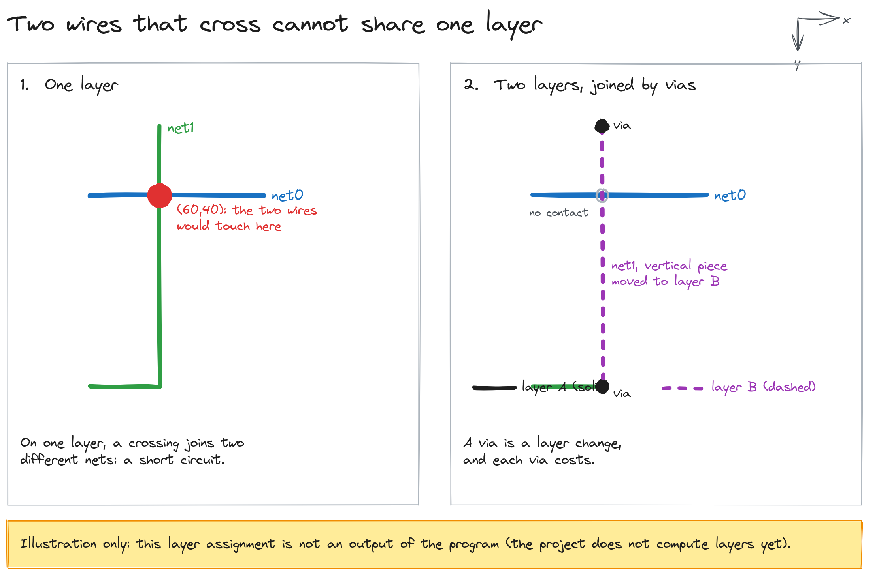
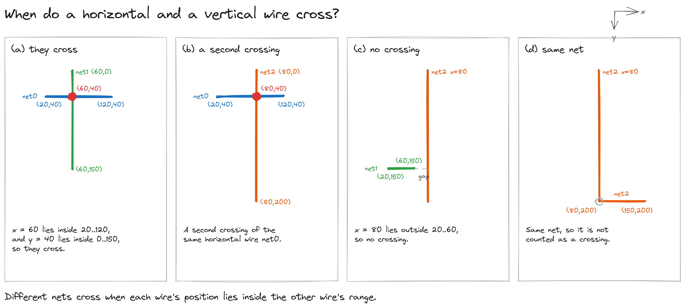
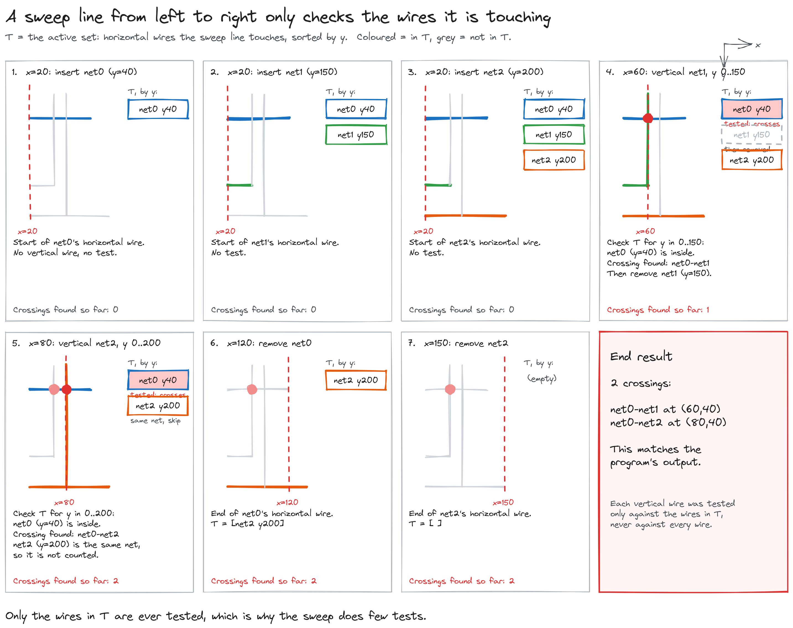
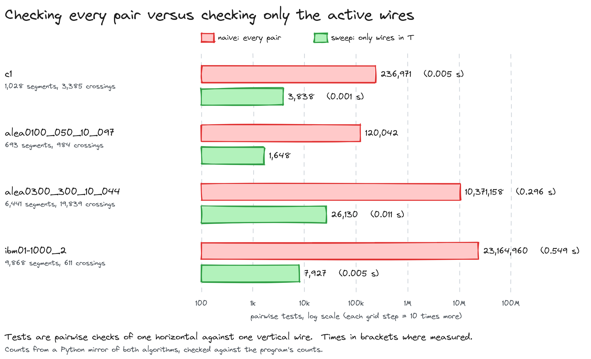
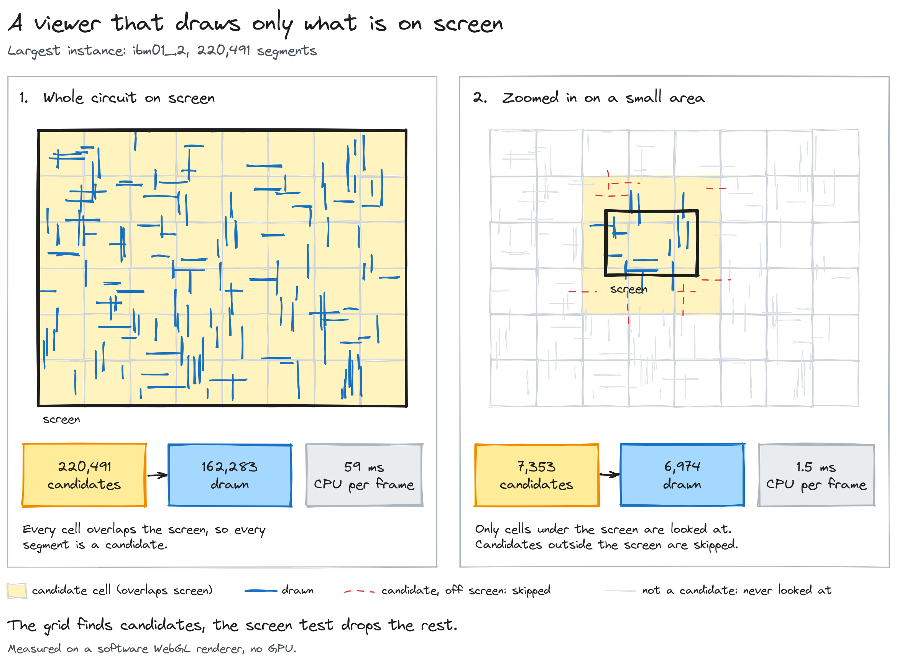

# Via_Minimization

A C project for a university algorithms course (2I006) on **via minimization** in chip layout. It reads a circuit, draws it, and finds every crossing between wires. Those crossings are what make the layout hard: wires that cross cannot share a layer.



## At a glance

| | |
| --- | --- |
| **What** | Reads a circuit netlist, draws it, and finds all crossings between wire segments with three algorithms: naive, sweep with a sorted list, and sweep with an AVL tree. |
| **For** | Students and anyone curious about sweep-line algorithms, balanced trees, and how chip layouts are checked. |
| **Stack** | C (gnu11), GNU make, WebGL for the viewer. |
| **Verified** | `make check` runs 16 assertions: the three methods agree, and the counts match the recorded values. The build passes with the project's own Makefile. |
| **Not built yet** | The via-minimization step itself (choosing the layer of each wire). See *Status*. |

## Learn the ideas

### 1. What a crossing is

A circuit is a set of **nets**. Each net is a group of points joined by straight **segments**, each one horizontal or vertical. In these instances, a horizontal and a vertical segment cross when the vertical one's x lies inside the horizontal one's range, and the horizontal one's y lies inside the vertical one's range. Two segments of the same net that touch are not a crossing.



### 2. Checking every pair is slow

The naive method compares every horizontal segment with every vertical one. With n segments, that is work proportional to n². It is simple, and it is the reference the other methods must agree with.

### 3. A sweep line checks only what it touches

Move a vertical line from left to right. Keep the horizontal segments it currently touches in a list sorted by y. When it reaches a vertical segment, only the horizontal segments whose y lies between that segment's ends can cross it. Those are the only ones to test.



The list of touched wires is kept in order. Inserting and removing costs time proportional to its length. An **AVL tree** keeps the same set balanced, so each insert, delete and search costs time proportional to its height, which stays logarithmic. The repository has both versions, and both return the same crossings as the naive method.

### 4. Why the sweep is faster

The sweep does far fewer pairwise tests, because it never looks at wires the line is not touching.



*The counts come from a Python mirror of both algorithms that matches the program's crossing counts exactly. The timings are from the C program, one run each.*

### 5. Two layers and vias

Wires that cross cannot share one layer. The fix is to put one of them on the other layer, and to connect its pieces with a **via**. Vias are costly, which is why the aim is to use as few as possible. The illustration above is only that idea: the repository does not yet compute the layers.

## Viewer for large circuits

`viewer/index.html` is a WebGL viewer that reads a `.net` file directly. Serve the repository root with any static server (for example `php -S 127.0.0.1:8080`), then open `viewer/index.html?file=../tests/ibm01_2.net`, or drop a `.net` file on the page.



How it stays fast:

- **Spatial grid.** Each segment is indexed in the grid cells its bounding box touches.
- **Viewport culling.** Only the cells that overlap the screen are visited, and each candidate is checked against the screen rectangle.
- **Level of detail.** A segment shorter than half a screen pixel is skipped at the current zoom.
- **GPU drawing.** The visible segments go to the graphics card as one line buffer and are drawn in one call.

Measured in headless Chromium on the software WebGL renderer (no GPU on the test machine), on `ibm01_2`:

| View | Candidates from the grid | Drawn | CPU time to prepare the frame |
| --- | --- | --- | --- |
| Whole circuit | 220,491 | 162,283 | 59 ms |
| Zoomed in | 7,353 | 6,974 | 1.5 ms |

Drawing speed on a real graphics card was not measured here.

## Results

Each row runs all methods on the same netlist and checks that they agree. Times are CPU seconds from one run of the C program.

| Instance | Segments | Crossings | Naive | Sweep (list) | Sweep (AVL) |
| --- | --- | --- | --- | --- | --- |
| `test` | 6 | 2 | 0.000 s | 0.000 s | 0.000 s |
| `alea0030_030_10_088` | 209 | 192 | 0.000 s | 0.000 s | 0.000 s |
| `alea0100_050_10_097` | 693 | 984 | 0.003 s | 0.001 s | 0.001 s |
| `c1` | 1,028 | 3,385 | 0.005 s | 0.001 s | 0.001 s |
| `alea0300_300_10_044` | 6,441 | 19,839 | 0.296 s | 0.011 s | 0.010 s |
| `ibm01-1000_2` | 9,868 | 611 | 0.549 s | 0.005 s | 0.005 s |
| `ibm01_2` | 220,491 | 318,387 | over 500 s, stopped | 0.79 s | 0.33 s |

On `ibm01_2` the naive method was stopped after 500 seconds without finishing, so its crossing count was not recorded. The two sweep methods agree with each other on that instance.

## Build and run

You need `gcc` and `make`.

```sh
make                                          # builds build/bin/*
make check                                    # runs the 16 assertions in src/test_crossings.c
./build/bin/tests_elementaires tests/c1.net   # counts the crossings of one netlist, with timing
./build/bin/VisuNetlist tests/c1.net out      # writes out.svg (the .svg suffix is added to the name)
```

Open the `.svg` in a browser to see the circuit. For large circuits, use the viewer above, because the SVG becomes very heavy.

## Status

- **Working:** reading a netlist from a `.net` file, drawing it as an SVG, the three crossing methods, the WebGL viewer, and `make check`.
- **Not implemented yet:** the via-minimization step. `minimize_via`, `bicolore` and `detect_cycle` in `src/netlib/graph.c` are empty placeholders, so the program does not produce a layer assignment. `nbr_via` counts the wrong thing: it tests the array pointer, not its entries.
- **Other tests:** `test_*.c` and `tests_elementaires.c` are demonstration drivers that print results. `make check` is the assertion test.
- **Unused functions:** `graph_dot`, `getindice_point`, `sauvegarder_intersections` and `verifier_nbintersection` are defined but never called.
- **Output naming:** `VisuNetlist` adds `.svg` to the name it is given, so `out` becomes `out.svg`.
- **Test output:** `tests_elementaires` writes `test_sauvegarde` into the working folder. It is ignored by git.

## Repository layout

```
src/netlib/           the library: netlist, segments, points, graph, AVL, sweep, SVG writer
src/                  the programs (VisuNetlist, the test drivers, test_crossings)
tests/                benchmark netlists (*.net)
viewer/               the WebGL viewer for large circuits
docs/assets/diagrams/ the diagrams used in this README
Projet_ViaMin_version1.pdf   the course statement
svgp.js               a browser script that adds pan and zoom to the SVG output
```
